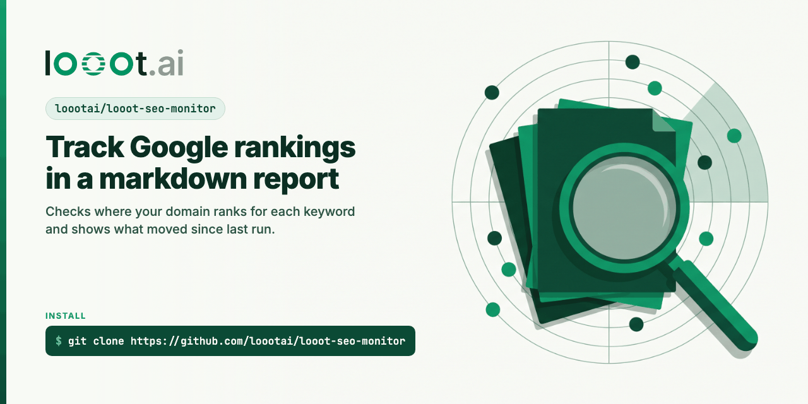
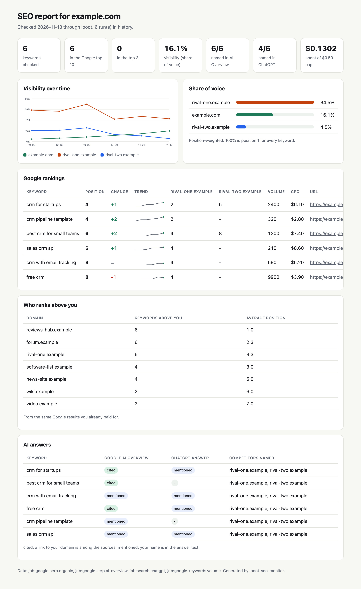

<p align="center"></p>

# looot-seo-monitor

[](LICENSE) [](https://github.com/loootai/looot-seo-monitor/releases) [](https://docs.looot.ai)

[](https://codespaces.new/loootai/looot-seo-monitor)

For a list of keywords, this tool checks three things each week:

1. Where your domain ranks on Google, next to your competitors.
2. Whether Google's AI Overview names your brand or cites your site.
3. Whether ChatGPT names your brand or cites your site.

It writes an HTML report and a markdown report, and keeps a history file so the next report shows what changed. It can also fetch search volume and CPC.

It is Python with no dependencies (standard library, 3.9 or newer). There is no server and no database. Data comes from [looot](https://looot.ai): one token and one prepaid balance. The price shows before anything runs, and a hard cap stops the spending.



*The sample report above uses made-up data (`python3 scripts/make_sample.py`), run through the same code as a live run. Files: [examples/sample-report.html](examples/sample-report.html), [examples/sample-report.md](examples/sample-report.md).*

## Try it without spending anything

```bash
git clone https://github.com/loootai/looot-seo-monitor
cd looot-seo-monitor
python3 -m seo_monitor --domain example.com --keywords examples/keywords.txt --all
```

That is a dry run, and the default. It needs no token and calls one free, public route. Real output from 2026-11-20:

```
Dry run. Nothing is spent.
2 keyword(s) for example.com.

| Check | looot job | Calls | Price each | Estimate |
| --- | --- | --- | --- | --- |
| Google rank | job:google.serp.organic | 2 | $0.0040 (assumed upper price) | $0.0080 |
| Google AI Overview | job:google.serp.ai-overview | 2 | $0.0018 | $0.0036 |
| ChatGPT answer | job:search.chatgpt | 2 | $0.0040 | $0.0080 |
| Search volume and CPC | job:google.keywords.volume | 1 | $0.0900 | $0.0900 |
| Total | | | | $0.1096 |
Hard cap $0.50. Each run is sent with fallback.maxCostUsd set to what is left.
```

Volume is one call for all keywords, so its $0.09 does not grow with the list. Leave out `--volume` and the same two keywords are quoted at about $0.02.

When the catalog lists $0 or no price for a job (a free own-key endpoint can pull the minimum to $0), the quote uses a stated upper price instead, so neither the quote nor the cap ever treats a check as free. Google rank was charged $0.0005 in practice.

## Run it for real

1. Sign up at https://looot.ai, top up (from $5), and create an agent token with the scopes `catalog.read`, `runs.read`, `runs.execute` and `usage.read`.
2. Run:

```bash
export LOOOT_TOKEN=...      # never commit this
python3 -m seo_monitor --domain example.com --keywords my-keywords.txt \
  --competitor rival.com --competitor other.com --all --max-cost 0.50 --live
```

| Flag | Meaning | Default |
| --- | --- | --- |
| `--domain` | Your domain. Subdomains count (`blog.example.com` matches `example.com`) | required |
| `--keywords` | Text file, one keyword per line, `#` for comments | required |
| `--competitor` | Competitor domain. Repeat it, or separate with commas | none |
| `--ai-overview` | Check Google AI Overview for each keyword | off |
| `--chatgpt` | Check ChatGPT's answer for each keyword | off |
| `--volume` | Search volume and CPC, one call for all keywords | off |
| `--all` | All three above | off |
| `--no-rank` | Skip the Google rank check | off |
| `--brand` | Extra name that counts as a mention of you, e.g. `--brand "Acme CRM"` | the domain and its first label |
| `--country`, `--location` | Passed to the SERP job (and location to volume) | none |
| `--max-cost` | Hard cap in USD for this run | 0.50 |
| `--out`, `--html` | Report paths | `report.md`, `report.html` |
| `--history` | JSON file of past results | `rankings.json` |
| `--live` | Spend money. Without it, a dry run | off |

## What it measures

- **Position**: the first result on your domain in the Google results, and the same for each competitor. Change is against the previous run in the history file: `+2` moved up two places, `-1` down one, `new`, `lost` or `=`.
- **Visibility (share of voice)**: positions weighted by how many clicks each spot usually gets (position 1 = 28%, 2 = 15%, 3 = 10% and so on down to 2% at 10). 100% means position 1 on every keyword. It is a comparison number, not a traffic forecast.
- **Who ranks above you**: domains that show up above you most often. It comes from the Google results you already paid for, so it costs nothing extra.
- **AI answers**: `cited` when a link to your domain is among the answer's sources, `mentioned` when your name appears as a whole word in the answer text, `-` when neither. For ChatGPT, sources are the links ChatGPT cites, not every page it searched. If your brand is a common word, pass `--brand` with the exact name.

## Cost

Measured on 2026-11-20 through looot, one keyword:

| Check | Charged |
| --- | --- |
| Google rank | $0.0005 |
| Google AI Overview | $0.0018 |
| ChatGPT answer | $0.0040 |

So 100 keywords with all three checks is about $0.63 a run, plus $0.09 if you add volume. Prices can change; the dry run always shows the current list price. Failed calls are free.

The cap: before each call the tool compares the listed price with what is left of `--max-cost`, and it also sends `fallback.maxCostUsd` equal to what is left, so looot itself refuses a call that would go over. Checks skipped at the cap are marked in the report and cost nothing.

Rerunning the same keywords on the same day replays the same looot runs at no charge (the idempotency key includes the date). A run on a later day is a fresh check.

## Use it from an agent (MCP)

Two ways, and they work together:

```bash
# This tool as an MCP server (stdio, standard library only)
claude mcp add seo-monitor -e LOOOT_TOKEN=... -- python3 -m seo_monitor.mcp_server

# looot's own remote MCP, for any other data job
claude mcp add --transport http looot https://api.looot.ai/mcp
```

The MCP server has three tools:

| Tool | Cost | What it does |
| --- | --- | --- |
| `seo_quote` | free | Price per check for a domain and keyword list |
| `seo_check` | paid | Runs the checks. `max_cost_usd` is required. Saves history, writes `report.html`, returns the markdown report |
| `seo_history` | free | The saved history as JSON |

Then ask: "Quote an SEO check for example.com on these 20 keywords with AI Overview and ChatGPT, then run it under $0.20 and tell me where rival.com beats us."

## Run it every week

Copy [examples/github-workflow.yml](examples/github-workflow.yml) to `.github/workflows/seo.yml` in your own copy and add `LOOOT_TOKEN` as a repository secret. It runs on Mondays, commits `rankings.json` back so the history grows, and uploads the reports. A GitHub-hosted runner costs nothing for a public repo.

## How it compares

Checked 2026-11-20 from each project's README and docs. "Cost per check" is one keyword on one Google results page.

| | looot-seo-monitor | OpenSEO | SerpBear | bisibility | SearchMirror |
| --- | --- | --- | --- | --- | --- |
| Google rank tracking | yes | yes | yes | yes | yes |
| Competitor share of voice | yes | yes | no | yes | partial |
| Google AI Overview visibility | yes | yes | no | partial | no |
| ChatGPT visibility | yes | yes | no | yes | yes |
| Search volume and CPC | yes | yes | yes | yes | no |
| Keyword ideas | no | yes | yes | yes | no |
| Backlinks | no | yes | no | yes | no |
| Site audit | no | yes | no | partial | no |
| Search Console data | no | yes | yes | yes | no |
| Web app | no, static HTML report | yes | yes | yes | yes |
| MCP server | yes | yes | no | yes | no |
| Price shown before a run | yes | yes | no | partial | request count |
| Hard spending cap per run | yes | partial | no | no | no |
| Accounts to set up | 1 (looot) | DataForSEO, plus OpenRouter for AI checks | a SERP API, Google Ads, SMTP | your provider keys | DataBlue, plus LLM keys |
| Runs on | Python 3.9, nothing else | Node or Docker, Postgres | Node or Docker | Node, Postgres 16, Temporal | Docker, MongoDB, Django |
| Setup time | about a minute | 10 to 30 minutes | 10 to 20 minutes | 30 minutes or more | 15 minutes or more |
| License | MIT | MIT | MIT | AGPL-3.0 | AGPL-3.0 |

Pick OpenSEO or bisibility if you want a full SEO suite in a web app with backlinks, audits and keyword research. Pick SerpBear if you want a self-hosted rank tracker with email alerts. Use this one if you want rank and AI answer tracking in one command, from a terminal, a GitHub Action or an agent, with no server and a cap on every run.

## Providers answer in different shapes

`seo_monitor/extract.py` reads each answer by looking for the first structure that fits (a list of results with a `link` or `url`, an answer text field, a list of citations) rather than one fixed path. The test mock in `tests/mock_server.py` copies the shapes the live providers returned on 2026-11-20. If a live run says "not in the results" where you do rank, print `run["result"]` once and adjust `extract.py`.

## Tests

```bash
python3 -m unittest discover -s tests -t .
bash scripts/leak-scan.sh .   # run before you push
```

The tests start a local mock of the looot API. They check that the dry run never starts a paid run, that every paid run carries the remaining cap, that the cap is never passed, the idempotency key per day, the AI Overview and ChatGPT parsing, share of voice, both reports, reading v0.1 history files, and the MCP server over stdio.

## License

MIT. Docs: https://docs.looot.ai. Support: https://looot.ai/contact.
